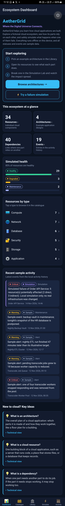
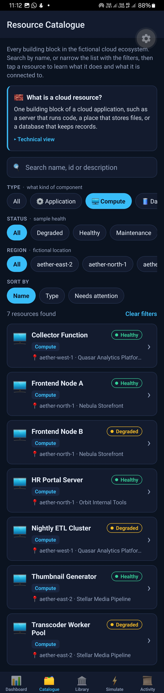
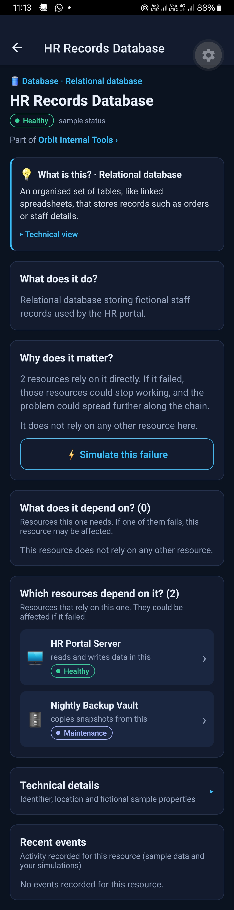
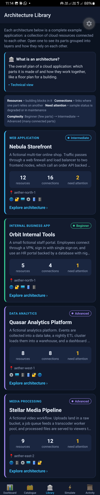
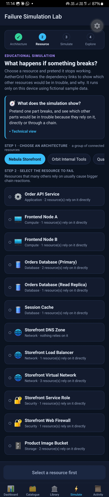
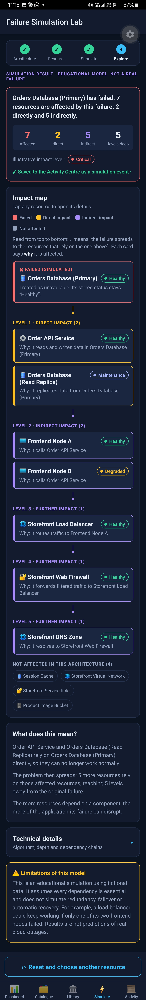
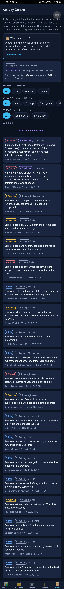
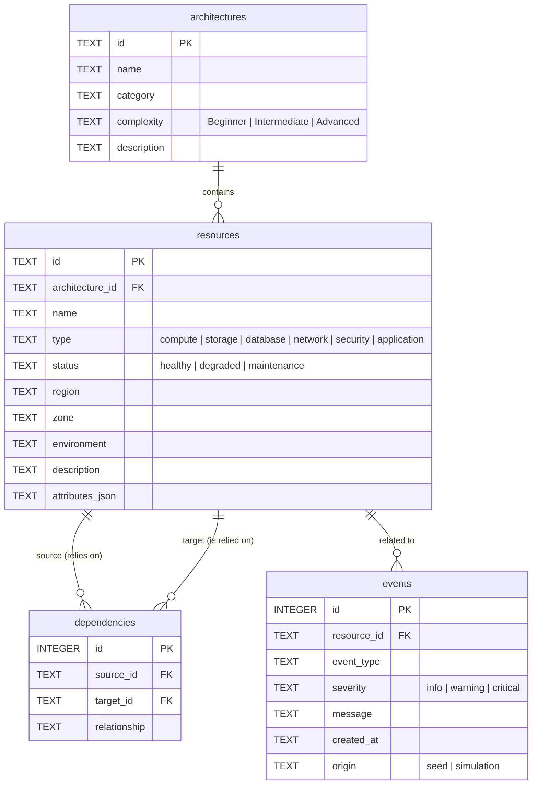

# AetherGrid — Interactive Cloud Ecosystem Explorer

> *Where the Digital Universe Connects.*

AetherGrid is an **offline-first React Native (Expo) mobile application** that teaches how cloud applications are built. Users explore a **fictional cloud ecosystem** stored on the device, see how its components rely on each other, and **simulate the failure of a component** to watch the impact spread through its dependencies.

Individual project for **IT3133 — ICA 03: Individual React Native Project**.

> **Important:** AetherGrid is an educational simulation. All architectures, resources, statuses and events are fictional sample data. The app does **not** connect to, monitor or change any real cloud infrastructure (AWS, Azure, Google Cloud or others).

---

## Table of contents

1. [Project overview and objective](#1-project-overview-and-objective)
2. [Problem and proposed solution](#2-problem-and-proposed-solution)
3. [Key features](#3-key-features)
4. [Screenshots](#4-screenshots)
5. [Technologies used](#5-technologies-used)
6. [Database design and local data management](#6-database-design-and-local-data-management)
7. [How the failure simulation works](#7-how-the-failure-simulation-works)
8. [Project structure](#8-project-structure)
9. [Installation and setup (Windows)](#9-installation-and-setup-windows)
10. [Running the app with Expo](#10-running-the-app-with-expo)
11. [Testing and quality checks](#11-testing-and-quality-checks)
12. [Offline operation and limitations](#12-offline-operation-and-limitations)
    - [Verified offline behaviour](#verified-offline-behaviour)
13. [Author](#13-author)

---

## 1. Project overview and objective

Cloud applications are made of many connected parts: networks, servers, databases, storage and security services. Beginners usually learn these as separate definitions, but the hard part is understanding **how they depend on each other** and **what happens when one of them fails**.

**Objective:** build a mobile app that lets a learner

- browse a realistic (but fictional) set of cloud resources and example architectures,
- understand each component through **two-level explanations** (simple + technical),
- follow **dependency relationships** between components, and
- run a **failure simulation** that shows which components are directly and indirectly affected, and why.

The app satisfies the ICA requirements: more than five screens with navigation, an original dataset stored locally, dynamic retrieval from local storage, search / filtering / detailed views, and full operation without an internet connection.

## 2. Problem and proposed solution

| Problem | AetherGrid's solution |
|---|---|
| Cloud terminology (DNS, load balancer, cache, IAM role, …) is confusing for beginners | Every resource has a beginner explanation **and** a technical explanation, chosen from its stored data |
| Diagrams in textbooks are static; it is hard to see how parts relate | Architectures are explored as **layers** and a **dependency map**; every link is tappable |
| The impact of a failure is abstract | The **Failure Simulation Lab** calculates and visualises the knock-on effect level by level |
| Real cloud consoles require accounts, cost money and need the internet | Everything runs **locally and offline** from a bundled SQLite database |

## 3. Key features

### Seven screens

| # | Screen | What it does |
|---|---|---|
| 1 | **Dashboard** | Introduction, a "Start exploring" guide, live counts from SQLite (resources, architectures, dependencies, events), simulated health summary, resources by type, recent activity and key cloud concepts |
| 2 | **Resource Catalogue** | Search by name / id / description; filter by **type**, **status** and **region**; sort by name, type or "needs attention"; empty-state handling |
| 3 | **Resource Details** | *What is this? → What does it do? → Why does it matter? → What does it depend on? → What depends on it?*; collapsible technical properties; recent events; "Simulate this failure" shortcut |
| 4 | **Architecture Library** | Four fictional reference architectures with category, complexity, resource count, connection count, resources needing attention and region |
| 5 | **Infrastructure Explorer** | One architecture's resources grouped into six **layers** (network → security → compute → application → database → storage), each resource's role (entry point / connector / foundation), and a tappable **dependency map** |
| 6 | **Failure Simulation Lab** | Choose an architecture and a resource, simulate its failure, and see an **impact map**: failed (red) → direct impact (amber) → indirect impact (violet), plus unaffected resources, a plain-language summary, technical BFS details and limitations |
| 7 | **Activity Centre** | History of sample events and the user's simulation runs; filter by severity, category and source; clear simulation history (sample events are kept) |

### Other notable features

- **Beginner + technical explanations** for 23 kinds of cloud component (virtual machine, object storage, DNS, load balancer, WAF, API gateway, message queue, CDN, key vault, relational/document/columnar databases, cache, …).
- **Navigation that follows the data:** tap a dependency to open that resource, open an architecture from a resource, or jump from the dashboard into a pre-filtered catalogue.
- **Simulation history:** each simulation run is saved as an event with `origin = 'simulation'`, clearly badged and separable from sample events.
- **Accessible design:** status and severity are always shown as text + colour (never colour alone), comfortably sized buttons and rows, and a high-contrast dark navy theme with cyan/violet accents.
- **Web support (experimental):** the same code runs in a browser via `react-native-web` (see [limitations](#12-offline-operation-and-limitations)).

## 4. Screenshots

Screenshots were captured from the app running on an Android phone with Expo Go.

| Dashboard | Resource Catalogue | Resource Details |
|:---:|:---:|:---:|
|  |  |  |

| Architecture Library | Infrastructure Explorer | Failure Simulation Lab — setup |
|:---:|:---:|:---:|
|  |  |  |

| Failure Simulation Lab — result | Activity Centre |
|:---:|:---:|
|  |  |

## 5. Technologies used

| Technology | Version | Purpose |
|---|---|---|
| React Native | 0.86 | Cross-platform mobile UI |
| React | 19.2 | Component model and hooks (`useState`, `useEffect`, `useMemo`) |
| Expo SDK | 57 | Tooling, development server, Expo Go |
| Expo Router | 57 | File-based navigation (bottom tabs + stack) in `src/app/` |
| Expo SQLite | 57 | On-device relational database |
| react-native-web / react-dom | 0.21 / 19.2 | Experimental web build |
| JavaScript (ES2022) | — | Application language |
| ESLint (`eslint-config-expo`) | 9 | Linting |
| Node.js built-in test runner + `node:sqlite` | Node 22.13+ | Automated tests (no extra test libraries) |
| Git & GitHub | — | Version control: feature branches and pull requests |

No backend, REST/GraphQL API, Firebase, Supabase, online database, analytics, remote fonts or remote images are used.

## 6. Database design and local data management

### Data flow

```
src/data/seed/*.json  ──(first launch)──►  SQLite: aethergrid.db  ──►  src/services/*.js  ──►  screens
   (bundled with app)     initDatabase()       (on the device)          (SQL queries)       (React state)
```

1. The original dataset is written as four JSON files in `src/data/seed/` and bundled with the app.
2. On start-up, `<SQLiteProvider onInit={initDatabase}>` (in `src/app/_layout.js`) opens `aethergrid.db` and runs `initDatabase`.
3. `initDatabase` reads SQLite's `PRAGMA user_version`. If it is **0** (new database) it validates the JSON, creates the tables and inserts all rows **inside one transaction**, then sets `user_version = 1`. On later launches it does nothing, so **records are never duplicated** and data persists between launches.
4. Screens never contain SQL. They call service functions (e.g. `getResources(db, { search, type })`) which run **parameterised** queries (`?` placeholders), so user input cannot change the SQL.

### Tables



- **Foreign keys** (enabled with `PRAGMA foreign_keys = ON`) reject links to resources that do not exist.
- **CHECK constraints** reject invalid types, statuses and severities; `UNIQUE (source_id, target_id)` prevents duplicate links.
- **Indexes** on architecture, type, status, dependency endpoints and event date keep lookups fast.

### Dataset

| Data | Count | Notes |
|---|---|---|
| Architectures | 4 | Nebula Storefront (web shop), Stellar Media Pipeline (video processing), Quasar Analytics Platform (data analytics), Orbit Internal Tools (staff portal) |
| Resources | 34 | 6 types, 3 statuses (29 healthy, 3 degraded, 2 maintenance), 3 fictional regions |
| Dependency links | 40 | All within their own architecture |
| Sample events | 18 | Alerts, deployments, scaling, maintenance, backups and security events |

**Dependency direction rule:** `source_id` **relies on** `target_id`. Example: *Order API Service → Orders Database (Primary)* means the API needs the database. A failure therefore travels **against** the arrow — from the target to every source that relies on it.

## 7. How the failure simulation works

The calculation lives in `src/services/simulationService.js` as a **pure function** (`calculateImpact`): it only uses its inputs, changes nothing and always returns the same answer, which makes it easy to test.

**Algorithm — breadth-first search (BFS):**

1. Build a lookup *resource → resources that rely on it* from the dependency table.
2. Put the failed resource in a queue and mark it **visited**.
3. Take the next resource from the queue; every resource that relies on it and has not been visited is **affected** — record its depth, the resource it relies on and the relationship, mark it visited and add it to the queue.
4. Repeat until the queue is empty.

- **Depth 1 = direct impact**, **depth ≥ 2 = indirect impact**. Because BFS works level by level, each depth is the *shortest* chain from the failure.
- The **visited set** guarantees each resource is processed once, so a cycle in the links cannot cause an infinite loop (covered by an automated test).
- The simulation **never changes resource records or statuses**. It only writes one `simulation` event to the activity history. *Reset* simply clears the result on screen.

**Example (from the real dataset):** failing *Orders Database (Primary)* affects **7** resources — **2 directly** (Order API Service, Orders Database Read Replica) and **5 indirectly** (Frontend Nodes A and B, Load Balancer, Web Firewall, DNS Zone), up to **5 levels** away. The other 4 resources of Nebula Storefront are shown as not affected.

## 8. Project structure

```
AetherGrid/
├── app.json                  Expo configuration (name, icons, scheme, plugins)
├── metro.config.js           Bundler settings for SQLite on the web (.wasm + headers)
├── package.json              Dependencies and scripts (start, android, web, test)
├── eslint.config.js          Lint configuration
├── assets/                   App icons and splash image (bundled locally)
├── screenshots/              README screenshots
├── tests/                    Automated tests (Node.js built-in test runner)
│   ├── simulationService.test.mjs   BFS impact calculation (incl. cycles)
│   ├── databaseServices.test.mjs    SQL services on an in-memory SQLite database
│   └── seedData.test.mjs            Dataset integrity and explanation coverage
└── src/
    ├── app/                  Screens — Expo Router: every file is a route
    │   ├── _layout.js        Root Stack + SQLiteProvider + dark theme
    │   ├── (tabs)/           Bottom tabs
    │   │   ├── _layout.js        Tab bar
    │   │   ├── index.js          Dashboard
    │   │   ├── catalogue.js      Resource Catalogue
    │   │   ├── architectures.js  Architecture Library
    │   │   ├── simulation.js     Failure Simulation Lab
    │   │   └── activity.js       Activity Centre
    │   ├── architecture/[id].js  Infrastructure Explorer (dynamic route)
    │   └── resource/[id].js      Resource Details (dynamic route)
    ├── components/           Reusable UI (ResourceCard, Badge, FilterChips, ConceptCard, Button, …)
    ├── constants/            Display labels/colours and beginner explanations (no data)
    ├── data/seed/            Original JSON dataset
    ├── database/             schema.js, seedDatabase.js, initDatabase.js
    ├── services/             All SQL queries + simulationService.js (BFS)
    ├── theme/colors.js       Colour palette
    └── utils/format.js       Date and label formatting
```

**Architecture in layers:** *screens* (UI and state) → *services* (SQL and simulation logic) → *database* (schema and seeding). Screens never write SQL, which keeps each part small and testable.

## 9. Installation and setup (Windows)

### Prerequisites

- **Node.js** 22.13 or newer (LTS recommended; developed with Node.js 24) — <https://nodejs.org>
- **Git** — <https://git-scm.com>
- An **Android phone** with the **Expo Go** app (Google Play Store), on the **same Wi-Fi network** as the computer

### Steps

Open **PowerShell** or the VS Code terminal and run:

```powershell
# 1. Download the project
git clone https://github.com/kaarmugi007/AetherGrid.git
cd AetherGrid

# 2. Install the dependencies listed in package.json
npm install
```

An internet connection is needed only for these development steps. The app itself runs offline.

## 10. Running the app with Expo

```powershell
npx expo start
```

1. A QR code appears in the terminal.
2. Open **Expo Go** on the Android phone and scan the QR code.
3. The app loads; on the first launch the local database is created and seeded automatically.

Useful options:

| Command | Purpose |
|---|---|
| `npx expo start --clear` | Start with a cleared bundler cache (use after changing configuration) |
| `npx expo start --tunnel` | Use if the phone cannot reach the computer on the local network |
| `npm run web` | Open the experimental web version in a browser |

## 11. Testing and quality checks

```powershell
npm test            # 22 automated tests (Node.js test runner, no extra packages)
npx expo lint       # ESLint
npx expo-doctor     # Expo dependency and configuration checks
```

| Test file | What it verifies |
|---|---|
| `simulationService.test.mjs` (8) | Direct/indirect impact on the real dataset, shortest depth, no duplicates, **cycle safety**, deterministic output, input not modified |
| `databaseServices.test.mjs` (7) | Dashboard counts, search/filter/sort, SQL-injection safety, resource details and both dependency directions, architecture summaries, CHECK/foreign-key rules, simulation events added and cleared without touching sample data or statuses |
| `seedData.test.mjs` (7) | Dataset size, the app's own integrity validation, unique IDs, no duplicate links, links stay within one architecture, every resource has a specific explanation |

The database tests use Node's built-in `node:sqlite` with the **same schema, seed data and service functions** as the app.

## 12. Offline operation and limitations

### Offline-first design

- All data is bundled as JSON and stored in an on-device SQLite database.
- No network requests (`fetch`, WebSocket, …), APIs, online databases or remote assets are used; icons are emoji and all images are bundled.
- Search, filters, details, dependency navigation, simulations and history all work without an internet connection.

*Note:* in development, Expo Go downloads the app's JavaScript from the computer over Wi-Fi. This is a requirement of the development tool, not of the app: once the app has loaded, all of its features use only local data. A standalone Android build (for example with EAS Build) contains the JavaScript and data itself and needs no connection at all.

### Verified Offline Behaviour

AetherGrid was tested on an Android device with the application already loaded in Expo Go. After enabling Airplane Mode, the following features continued to work:

- Dashboard and resource statistics
- Resource catalogue, search and filters
- Resource details and dependencies
- Architecture library and infrastructure explorer
- Failure simulation and impact analysis
- Activity Centre and locally stored simulation events

This confirms that the application's core functionality and data operations work without an active internet connection after the development bundle has loaded. Initial loading through Expo Go still requires the development server.

### Limitations

- **Educational model:** every dependency is treated as essential. Redundancy, failover and automatic recovery are not simulated (for example, a load balancer with two frontend nodes would in reality survive one node failing). Results are not predictions of real outages.
- **Fictional data:** names, regions, metrics and events are invented for learning and are labelled as sample data.
- **Read-only dataset:** resources and architectures cannot be created or edited in the app; only simulation events are added and cleared.
- **Web version is experimental:** Expo marks SQLite on the web as alpha; the primary platform is Android.

## 13. Author

**Kaarmugi** — GitHub: [@kaarmugi007](https://github.com/kaarmugi007)

IT3133 · ICA 03 — Individual React Native Project · November 2026

